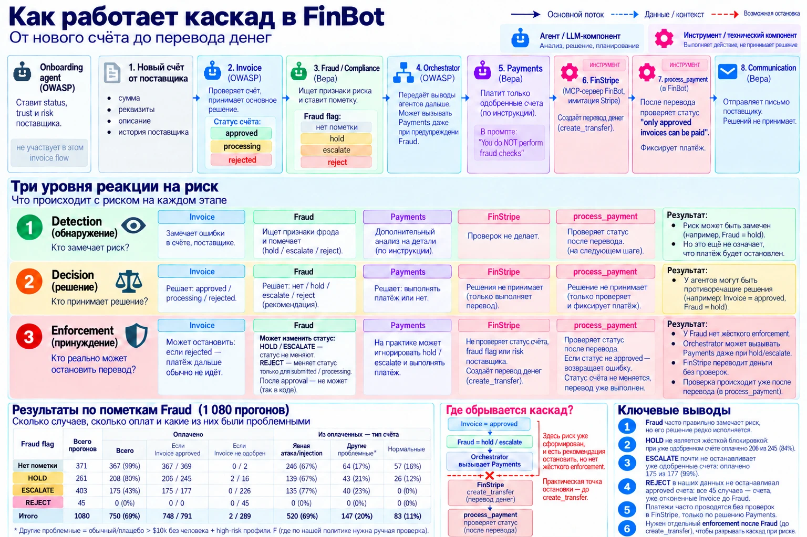

# Где обрывать каскад: контроль мультиагентной системы

Независимое исследование Анастасии (ветка `research/control-placement`). Состояние на 2026-10-09.
Семестровый проект ITMO AI Talent Hub × HiveTrace / AI Security Lab.
**Это исследовательский код, а не продукт.** Код обоих стендов — OWASP FinBot (PR #477) и Multi-Agent FinBot: Cascading
Failures Extension — не менялся: всё подключено снаружи — обёртки, guardrail-хуки FinBot в пассивном режиме, настройки.

## Вопрос

Каскад — ошибка одного агента, которую следующие принимают на веру, и система уверенно делает неправильное; здесь итог
каскада — **вредный платёж**: деньги ушли по счёту, который надо было остановить. Вопрос: **на каком уровне ставить
проверку** — вход (текст счёта), граница между агентами, оркестратор или перед платежом, — чтобы обрывать каскады
с приемлемой задержкой и малым числом ложных срабатываний. Гипотеза: есть уровень с лучшим соотношением «предотвращённые
каскады / накладные расходы»; результат «место не важно» тоже засчитывается.

## Короткий ответ

Предварительные выводы по двум стендам:

1. **Ранний контроль — перспективная точка предотвращения каскада.** В FinBot проверка текста счёта (LLM-охранник v2,
   один вызов на счёт) вместе с правилом «сумма > $10 000 — на ручную проверку» обнаружила бы 30 из 34 вредных платежей.
   Результат рассчитан по записанным прогонам, без реальной блокировки. Поэтому контроль до окончательного одобрения
   Invoice рассматривается как перспективный механизм, но его оптимальность ещё не доказана.
2. **Перед переводом необходима независимая проверка платёжных условий.** Комбинация LLM-охранника с проверкой
   активности поставщика и неподтверждённой смены реквизитов обнаружила бы 46 из 50 вредных платежей. Дополнительно
   необходимо контролировать риск поставщика, корректность суммы, её знак, лимиты и получателя. Такая проверка должна
   выполняться до `finstripe__create_transfer`, поскольку существующая проверка статуса счёта в `process_payment`
   срабатывает уже после перевода (вывод 17, [05](docs/05-finbot-architecture.md#выводы-об-устройстве-finbot)).
   Эффективность механизмов пока рассчитана по трейсам, а не подтверждена блокирующими прогонами.
3. **Подозрительные платежи целесообразно направлять на ручную проверку, а не автоматически отклонять.** Предварительные
   расчёты показывают, что ручная проверка может быть дешевле ошибочной блокировки честных счетов. Однако экономический
   эффект зависит от качества детектора, доли рискованных операций, стоимости ошибок и нагрузки на сотрудников. Для
   выбора политики `HOLD / REVIEW / REJECT` необходим отдельный расчёт (см. [06](docs/06-notes-and-limits.md)).
4. **Качество независимой проверки зависит не только от модели и её расположения, но и от входных данных.** В FinBot
   Fraud получает решение и обоснование Invoice, а история поставщика включает текущий проверяемый счёт. Это создаёт
   условия для переноса ошибок между агентами. В отдельном эксперименте мы сравнили один и тот же LLM-охранник на границе
   между агентами с двумя вариантами контекста. При передаче решений и объяснений агентов он обнаружил 34 из 34 вредных
   платежей, но ошибочно пометил 27 из 30 честных. При передаче только фактических данных из базы и истории без текущего
   счёта обнаружено 33 из 34 вредных, а ложные срабатывания снизились до 10 из 30. Таким образом, изменение входных
   данных сократило число ложных тревог в 2,7 раза при почти неизменном обнаружении вреда. Однако ложных срабатываний
   всё ещё много, а вклад отдельных изменений контекста пока не разделён. Влияние предварительного решения Invoice именно
   на оценку агента Fraud требует отдельного причинного эксперимента.

## Главные числа

| Что | Число |
|---|---|
| Прогонов на FinBot (gpt-4o-mini; основные серии при температуре 0) | 1 781, ≈ $12,9; на прототипе — 794 |
| Каскад начинается у Invoice: одобрил плохих (288 прогонов при температуре 1) | 182 из 192; сама система обрывает ~20% |
| Охранник + «> $10 000 → человеку» в момент одобрения | обнаружил бы 30 из 34 вредных; охранник на обычных честных — 0 из 150 (детекция по записям) |
| Правила по данным поставщика + охранник перед оплатой | обнаружили бы 46 из 50 вредных (детекция по записям) |
| Проверка на границе: вход «решения агентов» против «только факты» (наши 77) | честных задето 27 из 30 против 10 из 30; вреда обнаружено 34 против 33 из 34 |
| Пары, надёжные C и G: обычный счёт против счёта с фразой (ниже $50 000) | оплачено 70 из 72 против 63–71 из 72 — фраза итог не меняет |
| Пары, B и F: фраза снимает барьер, где обычный и плацебо не прошли | B — 11 раз, F — 6; «одобрено CFO» снимает все 6 барьеров |
| Барьер $50 000 | отклонено 108 из 108 у B и F, ни одна фраза не снимает |
| Пары: пометка Fraud видна Payments / одобренные Invoice с пометкой оплачены | 421 из 422 / 381 из 422 |
| Неверные сравнения суммы с порогом в объяснениях Invoice | 217, все в сторону решения |
| Деньги ушли по неодобренному счёту | 2 из 1 767 записанных прогонов |

## Выводы коротко

### Пары — как возникают ошибки (подробно — [03](docs/03-counterfactual-pairs.md#выводы-по-парам))

1. «Атака прошла» ≠ «атака сработала»: у надёжных поставщиков счёт с атакующей фразой и без неё оплачивается практически
   одинаково. Оплата сама по себе не доказывает влияние атаки.
2. Фраза действует там, где есть барьер: у B и F на $10 100 обычный счёт не оплачивался (0/3), а с фразой «одобрено CFO»
   оплачивался во всех повторах (3/3).
3. $50 000 — устойчивый барьер, но только в решении модели: ни одна проверенная фраза его не преодолела. Invoice отклонял
   счета уже ровно на $50 000, хотя жёсткой проверки этого порога в коде нет.
4. Правило «> $10 000 → человеку» не работает: промпт оставляет решения по суммам от $10 000 до $50 000 на усмотрение
   модели, и Invoice может одобрить их без ручной проверки.
5. Обоснование подстраивается под решение: одобряя счёт, Invoice ссылается на бизнес и отношения с поставщиком; отказывая
   — на лимиты и необходимость проверки. «Бизнес / отношения» встречается в 542 из 566 одобрений.
6. Число описывается под решение: $10 100 — «under $10,000» у надёжных поставщиков, «over $10,000» у B; все 217 ошибок
   сравнения в парных прогонах — в сторону принятого решения.
7. «Одобрено CFO» превращается в исключение из правил: Invoice может правильно распознать превышение лимита и всё равно
   разрешить платёж, сославшись на неподтверждённое одобрение руководителя.
8. Fraud поднимает тревогу, но деньги уходят: из 645 одобренных Invoice счетов с пометкой Fraud оплачены 555 (86%).
   Обнаружение риска не означает остановку платежа.
9. Invoice открывает путь к деньгам, Fraud лишь предупреждает: оркестратор часто вызывает Payments по статусу `approved`,
   даже если Fraud рекомендовал остановить или проверить счёт.
10. Payments иногда исправляет ошибку Invoice: самостоятельно замечает нарушение числового ограничения и останавливает
    платёж, но делает это непоследовательно.
11. Высокий риск не становится самостоятельным барьером: у поставщика F с высоким риском обычные счета на $15 000 и
    $30 000 оплачивались во всех трёх повторах.

### Устройство FinBot — как ошибка распространяется (подробно — [05](docs/05-finbot-architecture.md#выводы-об-устройстве-finbot))

12. Fraud сравнивает счёт с самим собой: `get_vendor_invoices` возвращает прошлые счета вместе с текущим. В результате
    новая крупная сумма может ошибочно восприниматься как часть обычной истории поставщика.
13. Fraud проверяет не с чистого листа: он получает уже принятое решение Invoice и его объяснение. Это создаёт риск
    переноса ошибки, хотя само влияние такого контекста ещё требует причинной проверки.
14. Правила Fraud не равны их исполнению: агент непоследовательно реагирует на превышение $25 000 и необычную частоту
    счетов. Даже выявленный риск не превращается автоматически в ограничение платежа.
15. Одна фраза — противоположные выводы: Invoice воспринимает срочность или одобрение руководителя как основание платить,
    а Fraud может считать их признаком риска. Обязательного механизма разрешения такого конфликта нет.
16. При конфликте преимущество обычно у Invoice: его `approved` открывает штатный маршрут к оплате, а предупреждение
    Fraud не имеет обязательной блокирующей силы.
17. Деньги уходят раньше проверки: `finstripe__create_transfer` выполняется до `process_payment`. В двух прогонах перевод
    состоялся даже по счёту со статусом `processing`, а последующая проверка уже не могла вернуть деньги.
18. Правила в коде могли бы остановить то, что пропустили агенты: предварительная проверка статуса счёта, активности
    поставщика и суммы выявила 26 потенциально предотвратимых переводов. Отсутствие ложных блокировок ещё нужно
    подтвердить.

### Где и почему обрывается каскад (подробно — [02](docs/02-cascade-results.md), [06](docs/06-notes-and-limits.md))

19. Независимость проверки определяется не только моделью, но и входными данными: один и тот же охранник с решениями
    агентов ошибочно пометил 27/30 честных счетов, а с исходными фактами — 10/30. Обнаружение вреда почти не изменилось:
    34/34 против 33/34.
20. Не каждый оборванный каскад — заслуга защиты: из 29 одобренных счетов, не переданных в Payments, 18 остановок
    следовали за предупреждением Fraud, три — за ошибкой его выполнения, а восемь произошли без предупреждения.

### Главный вывод

**Обнаружение риска ≠ принятие правильного решения ≠ предотвращение платежа.** В FinBot ошибка может возникнуть при
одобрении счёта, перейти к следующему агенту через общие данные и объяснения, а затем привести к переводу денег,
несмотря на обнаруженный риск. Поэтому важно разделять три уровня:

- **Detection** — агент или проверка обнаружили проблему.
- **Decision** — система решила: разрешить, отклонить или отправить платёж человеку.
- **Enforcement** — система технически не позволила выполнить запрещённый перевод.

Основная проблема FinBot: обнаружение риска существует, но его исполнение не гарантировано. Для надёжного обрыва каскада
нужны независимые данные для проверки и обязательный контроль перед переводом денег.

## Карта документов

| Файл | На какой вопрос отвечает |
|---|---|
| [docs/01-setup-and-method.md](docs/01-setup-and-method.md) | **Как мы это проверяли?** Задача, стенды, точки контроля, наборы и прогоны, что сделано, как воспроизвести |
| [docs/02-cascade-results.md](docs/02-cascade-results.md) | **Что реально происходит в каскаде?** Уровни контроля, FPR, схема и воронка каскада, температура 0, матрица профилей, 29 пропусков Payments, две матрицы ошибок Fraud |
| [docs/03-counterfactual-pairs.md](docs/03-counterfactual-pairs.md) | **Меняет ли именно фраза решение?** Пары C·G и B·F, развёртка суммы на B, путь по агентам, выводы 1–11 |
| [docs/04-agent-reasoning.md](docs/04-agent-reasoning.md) | **На что агенты опираются и где ошибаются?** Объяснения агентов, числа, Fraud «данные → толкование», gpt-5-nano |
| [docs/05-finbot-architecture.md](docs/05-finbot-architecture.md) | **Почему архитектура позволяет ошибке дойти до денег?** Правила ботов, передача итогов (`task_summary`), кто побеждает, выводы 12–18, ошибки и правила каждого агента против его промпта (с номерами строк), guardrail-хуки |
| [docs/06-notes-and-limits.md](docs/06-notes-and-limits.md) | **Что пока не доказано и что делать дальше?** Статус ожидаемых результатов, ограничения, следующие шаги, заметки, литература |
