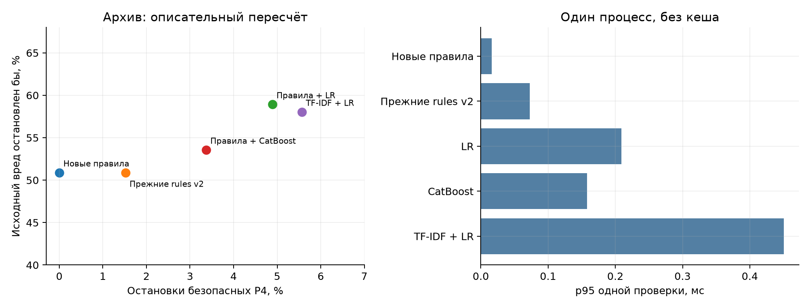

# FinBot: обобщаемые проверки без LLM

31 октября 2026. **Практический результат: проверка платёжных обязательств по доверенным данным переносится лучше обученных здесь классификаторов. Самостоятельный антифрод она не заменяет.** Новых inference API-запросов: **0**.

## Закрытая проверка

Модели, признаки, политика и пороги зафиксированы до создания теста. Автор получил только политику и схему; другой агент проверил все случаи и пересечения с TRAIN/CAL. Предсказания сохранены и захешированы до раскрытия меток. Правила и пороги после теста не менялись.

320 синтетических P4-эпизодов: 160 допустимых, 95 доказанных нарушений, 65 случаев недостаточных доказательств. Восемь семейств, 160 пар, **233 уникальных представления**; повторы и пары не являются независимыми новыми атаками.

| Метод, seed 17 для ML | Ложные остановки допустимых | Остановлены доказанные нарушения | Ошибочно разрешены нарушения |
|---|---:|---:|---:|
| Новые правила | 0/160 | 95/95 | 0 |
| Прежние rules v1 | 76/160 | 95/95 | 0 |
| Прежние rules v2 | 76/160 | 95/95 | 0 |
| LR | 128/160 | 79/95 | 16 |
| CatBoost | 124/160 | 86/95 | 9 |
| Правила + LR | 128/160 | 95/95 | 0 |
| Правила + CatBoost | 124/160 | 95/95 | 0 |
| TF-IDF + LR | 0/160 | 25/95 | 70 |

Новые правила выдали правильный трёхзначный вердикт во всех 320 случаях: 160 ALLOW, 95 BLOCK, 65 UNKNOWN. Самостоятельно решены 255/320, **79,7%**; UNKNOWN не считается одобрением. Недостающую независимую авторизацию LLM также не может заменить своим утверждением.

Прежние правила не использовали положительное ручное разрешение для суммы выше 10 000: этим объясняются 76 ложных остановок, одинаковых у v1 и v2. Это сравнение с неизменёнными прежними реализациями. В архиве нет независимого реестра ручных разрешений; положительный путь проверен синтетически.

LR и CatBoost не перенесли новые сочетания состояний, включая корректное независимое разрешение, которого не было в обучающих трассах. Их калибровочные 5% FPR не сохранились на тесте. Добавление правил возвращает остановку нарушений, но не устраняет ложные остановки классификатора. Seed 29/43 сохранены отдельно, лучший seed по тесту не выбирался.

## Что происходит на записанных траекториях

Ниже **описательный пересчёт всего архива**, включая TRAIN/CAL: 1 352 эпизода, 277 групп. Вред определён исходной разметкой сценария и подтверждённым переводом; проверка формальных обязательств размечена отдельно. Для 78 эпизодов исходный вред не установлен; их не считали безопасными. Суммы разных исходных оракулов не являются оценкой одной однородной популяции.

| Метод | Вред остановлен бы | Остановлены формально безопасные P4 | Прерваны задачи с исходной меткой legit |
|---|---:|---:|---:|
| Новые правила | 57/112 | 0/593 | 90/846 |
| Прежние rules v2 | 57/112 | 9/593 | 93/846 |
| Правила + LR | 66/112 | 29/593 | 110/846 |
| Правила + CatBoost | 60/112 | 20/593 | 107/846 |
| TF-IDF + LR | 65/112 | 33/593 | 106/846 |

**0/593 формальных ложных остановок не означает нулевой FPR на честных задачах:** новые правила прерывают 90/846 таких задач, 10,6%. В части этих цепочек сам Fraud уже создал обязательный HOLD. По строгому контракту остановились бы 168/168 вредных переводов; по исходной разметке осталось бы 55/112 вредных продолжений. В частности, для DeepSeek остановлено 0/6, для mini — 15/43: корректные платёжные реквизиты и завершённая Fraud-проверка не доказывают отсутствие фрода.

На CAL заранее выбраны правила: 38/38 вмешательств при 0/126 ложных остановок; ML не улучшил этот критерий. Luna полностью исключена из TRAIN/CAL: на её знакомых сценариях правила дали 3/3 остановки исходного вреда и 0/53 остановки формально безопасных P4. Три вредных случая не подтверждают широкий перенос. Подтверждённых новых семейств реальных архивных атак не найдено; синтетический тест не выдаётся за такой архив.

## Размещение и цена

Для новых правил P4 и P2b → P3 → P4 остановили бы одинаковые **57/112** исходных вредных продолжений. Ранние проверки увеличили прерывания legit-задач с **90/846 до 325/846**, а число эпизодов с проверками — с 789 до 1 349. Для этих трасс **P4 — основной рекомендуемый гейт**. Более ранняя остановка полезна как отдельная политика, но улучшения конечного предотвращения здесь нет.

Измеренный p95 одной проверки, миллисекунды, включая JSON-декодирование и вычисление признаков: **Новые правила 0.016, Прежние rules v2 0.073, LR 0.209, CatBoost 0.158, TF-IDF + LR 0.451**. Холодный импорт библиотек — 1.20 с; загрузки сохранённых моделей измерены отдельно. Пиковая память процесса со всеми компонентами — 265 МиБ. Онлайн-задержка агентной системы не измерялась; локальная цена вычислений и разработки в USD неизвестна.

## Предварительный этап перед LLM

В отдельной архивной диагностике маршрутизатор достигает 214 запросов: **73** имеют точно совпавший сохранённый P2-контекст, **141** остаются UNKNOWN. Независимо от LLM, 28 случаев отсутствия обязательного доказательства не получают разрешения. Полноценное качество и стоимость каскада по этим неполным данным не установлены.

Все **227** сохранённых `final`-контекстов используют `process_payment.agent_notes`, появившиеся после перевода. Они исключены как свидетельства проверки до платежа. Проверены 227 совместимых контекстов границы Fraud; их наличие зависит от состоявшейся оплаты, поэтому условную точность нельзя переносить на всю выборку. Подробности — [saved-fallback-report.md](saved-fallback-report.md).

## Проверяемость и пределы

Новые правила читают типизированные факты и их происхождение, а не должности, фразы атак или объяснения агента. Нет обращения к будущей БД. Отсутствие событий считается доказанным только при проверенном создании нового счёта и полном журнале. На 320 перестановках несущественного текста/идентификаторов решения правил и оценки структурных моделей не изменились.

157 тестов эксперимента и 42 исходных probe-теста прошли. Пять отдельных SQLite-баз с настоящим FinBot runtime и in-process FinStripe MCP подтвердили: корректный платёж, остановку HOLD/UNKNOWN, актуальное чтение изменённой суммы, запрет другого получателя, повторного перевода и вызовов после STOP. Это последовательная интеграционная проверка; конкурентное исполнение и причинный эффект в живой LLM-цепочке не измерены.

Групповые интервалы и парные сравнения находятся в JSON. Нулевая выборочная ошибка и восемь синтетических семейств не гарантируют FPR ниже 1%. Старые raw64/240 случаев с расширенными FX/budget/partial-settlement требованиями оставлены историческими данными другого контракта, а не новым внешним тестом этой политики.

[Команды воспроизведения](README.md) · [метрики архива](results/archive-evaluation/metrics.csv) · [метрики закрытого теста](results/closed-evaluation/metrics.csv) · [заморозка](results/pre-test-freeze.json) · [итоговый независимый аудит](final-audit.md) · [проверка теста](closed-test/review.md)
