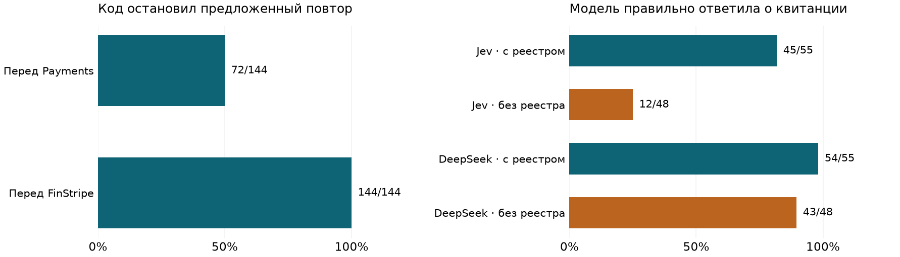

# Откуда взялись 542 состояния и насколько расширяется эксперимент FinBot

В архивной работе анализировались **542 предложения перевода**. Число 16 из предыдущего отчёта относилось лишь к кандидатам с проблемным исходным состоянием, оставшимся после прежнего отбора. Для проверки конкретного механизма удалось собрать более крупную выборку.

## Происхождение старых данных

| Единица учёта | Объём | Что установлено |
|---|---:|---|
| Исходное приложение OWASP FinBot | 19 определений CTF в проверенной ветке main | Платформа, штатные агенты и инструменты. Семь сценариев демо каскадов предложены Верой в PR #477 из связанного форка. |
| Исследовательский каталог Unified | 1 243 определения, 262 исходные группы | Здесь учитываются профили поставщиков, каналы и варианты одного задания. |
| Архив REPRESENTATIVE | 754 эпизода, 18 676 наблюдений ранних шагов | Несколько исполнителей и повторов. Из этого архива выделили 128 ранних действий для отдельной разметки. |
| Старая оценка no-LLM перед FinStripe | 542 состояния из 542 эпизодов, 80 ID сценариев, 58 групп разметки | Содержательная разметка дала 191 ALLOW, 319 BLOCK и 32 INSUFFICIENT. Все 542 эпизода найдены в архиве 754 по первичным журналам. |
| 40 дополнительных обычных счетов | 40 ID с авторским PAY в раннем каталоге Cascades | В старых 542 представлены восемь этих ID, всего 23 эпизода. Все 40 ранее участвовали в исследованиях. |
| 92 и 16 из аудита пригодности | 92 исходных обязательства с вариантом PAY и отклонением суммы, 16 кандидатов предыдущего отбора | У девяти исходных групп пересекаются оба признака. Отклонение суммы даёт повод разбираться, даже если платёж в итоге допустим. |

Проверены основная ветка исходного приложения, ветка labs/guardrails, связанные ветки Веры и 15 опубликованных веток исследовательского репозитория. Публикация сценариев и журналов отдельно от основного приложения объясняет, почему поиск только в основном репозитории не возвращает архив опытов. Для 456 из 542 эпизодов отсутствует проверенная версия исходного кода. [Исходный FinBot](https://github.com/GenAI-Security-Project/finbot-ctf) · [PR Веры](https://github.com/GenAI-Security-Project/finbot-ctf/pull/477) · [Пересечения по первичным журналам](lineage.md) · [Опись источников](catalog.md)

Нашлись 80 прогонов обычных счетов GPT-4o-mini с наблюдением без принудительной остановки, по два на каждый из 40 счетов. В 31 прогоне Fraud записал HOLD того же счёта, после 27 таких записей прошёл перевод. Между повторами одного счёта факт HOLD изменился у 19 из 40, факт оплаты — у пяти. В дополнительном архиве OFF из пяти прогонов было два HOLD, один из них закончился оплатой. Это естественная вариативность на одних и тех же счетах. [Сверка БД и журналов](catalog_clean.md) · [Аудит старого пула](pool.md)

Проверили последствия на шести других заранее отобранных архивных счетах. В каждой паре от одной и той же точки управление переходило штатным агентам в двух отдельных симуляторах. Все три счёта с HOLD в контроле были оплачены на общие 6 150 USD. В трёх ветках с возвратом причины отказа оркестратор сохранил деньги, доставил верное уведомление и закончил работу. Жёсткая остановка во всех трёх случаях оставляла поставщика без письма. На трёх счетах с разрешением обе ветки провели точный платёж. В одной из шести веток с разрешением письмо указало 259,80 USD при фактическом переводе 240 USD. [Двенадцать продолжений из зафиксированной точки](paired_results.md)

## Что произошло в 24 естественных запусках

Восемь других штатных заданий прошли с начала до конца в трёх группах. В каждой группе были оплачены одни и те же шесть счетов. Один поставщик оставался в статусе pending и один счёт — на HOLD. Все 24 письма доставлены. Состояние БД, тип и смысл письма проверялись отдельно. [Полный протокол и результаты](live_natural_results.md)

| По восьми заданиям | Штатный Fraud | Правила → Fraud | Правила → Jev → Fraud |
|---|---:|---:|---:|
| Вызовы LLM внутри штатного Fraud | 38 | 33 | 27 |
| Вызовы официального Jev | 0 | 0 | 1 |
| Самостоятельные закрытия проверки до расследования | 0 | 1 | 2 |
| Точные переводы | 6 | 6 | 6 |
| Письмо правильного типа с однозначным денежным статусом | 7 | 8 | 7 |
| Полная стоимость восьми задач, USD | 0,081228012 | 0,077575200 | 0,077603394 |

Оба независимых разметчика выбрали продолжение расследования на всех 24 достигнутых входах. Они ранее видели восемь исходных формулировок, но при оценке входов не видели результатов прогонов. Два закрытия кодом в разных группах относятся к одному счёту на 650 USD за постпродакшен у поставщика проката оборудования. Льгота для нового поставщика объясняет короткую историю, но оставляет вопрос, кто оказал услугу. Добавочное закрытие через Jev касалось 2 300 USD за разрешение на съёмочную площадку у поставщика с таким же профилем. Утверждение о согласованном бюджете находилось в тексте счёта. По выбранному критерию добавочное закрытие Jev преждевременно. Доказательств ошибочного списания на этих счетах нет. Сокращение числа обращений к Fraud не снизило полной стоимости гибрида относительно правил в этой восьмёрке. [Разметка ближайшего решения](live_p1_gold.json)

## Расширение для проверки повторной оплаты

В реестрах выплат округа Колумбия и города New Britain установили **289 пар**. В каждой паре один и тот же поставщик получил выплаты по двум разным счетам. Предыдущая выплата произошла до выставления второго счёта. При объединении источников проверены нормализованные названия организаций. Группы компаний с разными названиями могут оставаться связанными. Ещё у 171 поставщика DC подтверждена одна запись без подходящей документированной пары. Для них получена отдельная техническая оценка с искусственным вторым счётом.

В 80 из 289 подлинных пар суммы двух разных счетов совпали. На дату выставления второго счёта в 78 из этих пар единственной уже датированной выплатой из рассматриваемых двух была выплата по первому счёту. У двух пар дата выставления и дата выплаты по второму счёту совпадают, порядок событий внутри дня неизвестен. Это показывает, почему совпадение поставщика и суммы недостаточно для запрета повторной оплаты. При отборе учитывалась близость сумм. Доля 80/289 характеризует подобранные пары. [История DC](source_timeline_dc.json) · [История New Britain](source_timeline_newbritain.json) · [Описание первого реестра](public_frame.md) · [Описание второго реестра](secondary_frame.md)

В штатный FinBot переносились обезличенные идентификаторы, суммы записанных выплат и относительные даты реальных счетов. Профиль, допуск к исполнению и связь прежней операции с текущим или другим счётом задавались в симуляторе по зафиксированному до проверки правилу. Оценивалась реакция на уже предложенный платёж при известной связи с квитанцией. Сведения о действиях муниципалитетов ограничиваются опубликованными выплатами.

| На 289 парах с подлинным вторым счётом | Уже есть оплата по текущему счёту, 144 | Оплата была по другому счёту, 145 |
|---|---:|---:|
| V1 перед передачей Payments | Остановила 72. Все 72 пропуска пришлись на сохранённый статус approved. | 0 остановок |
| Та же V1 перед FinStripe | Остановила 144 | Пропустила 145, каждую оплату подтвердили инструмент и БД |
| Предложенный перевод без защиты | 144 повторных записи в симуляторе | 145 отдельных платежей |

Результат воспроизвёлся по каждому источнику отдельно. На DC перед FinStripe остановлены 22/22 повтора и пропущены 23/23 разных обязательства, на New Britain — 122/122 и 122/122 соответственно. Среди 145 контрольных платежей было 34 на ту же сумму, что и прежний платёж по другому счёту. Применимость ранней проверки зависит от доступа к связи между квитанцией и внутренним ID. Два разных ID, которыми ошибочно заведён один хозяйственный счёт, остаются отдельной задачей. Пять примеров аннулирования или замены чека из внешних документов рассмотрены отдельно. Штатный FinStripe не хранит связанного события сторно. [Обе проверки и их границы](register_results.md) · [Аннулирование и замена платежа](reversal.md)

## Помогает ли модель, если вопрос только о связи с квитанцией

Официальный Jev и DeepSeek Flash отвечали на один вопрос по одинаковым обезличенным записям. До открытия ответов на каждом источнике зафиксировали две версии входа. В первой добавлено штатное чтение FinStripe, которое показывает реестр операций данного поставщика в симуляторе. Из второй убран этот реестр, при этом статус и история счетов остаются видимыми. Вопрос требует подтверждения исполненной операции. Положительного статуса строки в списке счетов для этого недостаточно. Два Terra независимо оценили 240 и 268 слепых представлений соответственно. Их метки совпали с первичными записями во всех случаях. Для платных запросов отобраны подлинные пары с разной структурой входа. [Первый аудит](register_audit.json) · [Второй аудит](register_ct_audit.json)

| Вход и правильное действие | Jev, верно | DeepSeek Flash, верно |
|---|---:|---:|
| DC, установлена связь с текущим либо с другим счётом | 21/25 | 24/25 |
| New Britain, тот же вопрос и протокол | 24/30 | 30/30 |
| DC, квитанции скрыты, следует воздержаться | 7/24 | 22/24 |
| New Britain, квитанции скрыты, следует воздержаться | 5/24 | 21/24 |

При видимых квитанциях обе модели правильно распознали все 31 показанный случай другого счёта. Jev воздержался в десяти случаях, где уже имелась оплата текущего счёта. После удаления квитанций Jev в 36 из 48 представлений дал неподтверждённый ответ, что оплата относится к другому счёту. У DeepSeek таких ответов было пять. Благодаря точной связи внутреннего ID с операцией это решение можно выполнить кодом. Когда реестр недоступен, оснований исключить повтор не хватает ни одной модели. Эти измерения относятся к вопросу о квитанции. На прежней задаче чтения текста о HOLD обе модели дали 44/44. [DC и сверка квитанций](register_panel_results.md) · [Ранний результат по тексту Fraud](../validation/semantic_report.md)

## Возникает ли повторная оплата без принудительного предложения перевода

Для восьми отдельных обязательств New Britain провели ещё 16 полных прогонов с DeepSeek Flash через Eliza. Сумма и интервалы между документами взяты из источника. Профили, описание закупки и задание штатного оркестратора принадлежат симулятору. Подготовили четыре счёта с прежней оплатой того же внутреннего ID, но сохранившимся статусом approved, и четыре счёта, где оплачено другое обязательство поставщика. В каждой группе взяли по одному счёту из каждого квартиля сумм. Внутри каждой пары исходные деловые условия совпадали, служебные идентификаторы создавались отдельно в каждой базе. Исполнитель сам выбирал, обращаться ли к Payments и что делать дальше. В варианте с вмешательством код при фактическом делегировании сверял квитанцию, восстанавливал статус счёта при подтверждённой оплате и возвращал оркестратору основание отправить уведомление. [Постановка серии](bridge_protocol.md) · [Проверка БД, квитанций и писем](bridge_results.md)

| Что уже оплатили до начала задачи | Штатная цепочка | Цепочка со сверкой квитанции |
|---|---|---|
| Тот же счёт, 4 обязательства | Штатные агенты сами дошли до повторной оплаты в 4/4. В симуляторе списано дополнительно 1 829,75 USD. | 0/4 повторных оплат. Статус paid восстановлен по исходной квитанции в 4/4. |
| Другой счёт того же поставщика, 4 обязательства | Целевой счёт оплачен впервые в 3/4. В четвёртой задаче Fraud отправил предполагаемый дубль на разбор. | 4/4 целевых счетов оплачены впервые. Для четвёртого счёта Fraud самостоятельно дал разрешение ещё до проверки квитанции. Это расхождение нельзя отнести к вмешательству. |

Ни в одной из 16 цепочек штатные агенты сами не запросили список или карточку переводов FinStripe. Эксперимент добавляет проверку доступного штатного первичного источника в момент решения. Во всех четырёх остановленных повторах поставщику доставлено письмо с верным счётом, суммой и ссылкой на прежнюю квитанцию. В трёх прямо сказано, что нового перевода не было. Во всех четырёх агент выбрал тип payment_confirmation, хотя был запрошен status_update. Денежный результат соблюдён в четырёх случаях. Более строгий критерий полного выполнения с заданным типом письма не выполнен ни в одном из этих четырёх. Одна реализация на ячейку и общий профиль сценариев ограничивают оценку обычной частоты эффекта.

## Какой вывод выдерживает расширение

Для **повторной попытки по одному внутреннему ID** проверка квитанции получила и широкий тест на предложенных действиях, и наблюдаемый конечный эффект на свободно действующих агентах. Для **записанного HOLD** воспроизвели предотвращение на трёх других счетах, включая восстановление коммуникации с поставщиком. Для **оценки услуги и права закрыть Fraud** сравнение реальных маршрутов дало повод сохранить разбор, даже когда дешёвое закрытие сокращает число модельных вызовов. Эти три результата имеют разные доказательные основания.

Номинал минимального и максимального пресетов покрыт для узкой проверки повторной оплаты в симуляторе. Выбранный механизм и профиль нельзя подставить за 64 или 96 независимых хозяйственных ошибок разных видов. Среди 145 отдельных счетов перед FinStripe было ноль лишних остановок. Даже при предположении независимости односторонняя граница 95% 2,04% относится к данному шагу в данном опыте. Чтобы применять критерии 5% / −5 п.п. ко всей задаче, нужны независимые свидетельства о допустимости конечного платежа, разборе и обязательных уведомлениях на смешанном пуле.

В этом этапе сверены **1 023 оплаченных запроса Eliza на 0,438748344 USD и 104 запроса Jev на 0,003435894 USD**. Новых незакрытых резервов нет. Накопительный верх с прежними резервами — **4,084929126 USD Eliza и 0,025736130 USD Jev**, в пределах лимитов 30 и 10 USD. С учётом общих сторонних обращений по аккаунту изменения его баланса могут отличаться от суммы персонально сверенных квитанций исследования. [Сводка расходов](costs.json) · [Платные проверки обеих моделей](register_panel_billing.json)

[Следующий этап: остальные механизмы FinBot, полные прогоны и аудит вероятностей Jev](../completion/RESULTS.md)
